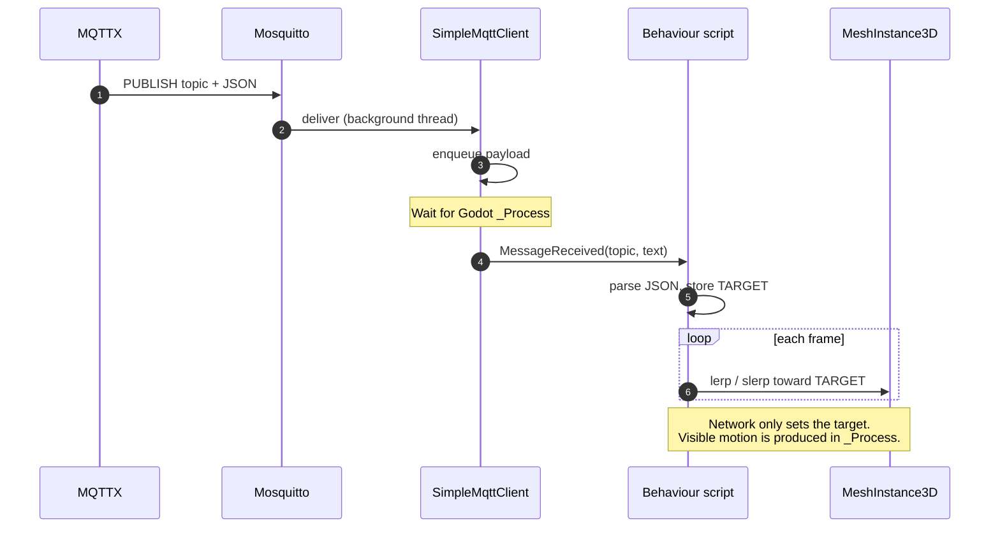

# Lab 03A — Godot MQTT motion (warmup)

**Course:** INC492 Digital Twin  
**Folder:** `labs/godot-simple`  
**Level:** Warmup before the full coupled-tank twin ([Lab 03](../godot/README.md))

This short lab teaches the same **MQTT → Godot → 3D motion** pattern used in the full twin, but with two simple boxes instead of tanks and an HMI. After you finish here, Lab 03 should feel familiar: subscribe, parse JSON, update the scene on the **main thread**, and ease motion so it looks smooth.

---

## 1. Learning objectives

By the end of this lab you should be able to:

1. Explain the **publish / subscribe** roles of MQTTX, Mosquitto, and Godot.
2. Connect a Godot **C#** script to the Lab 01 broker (`localhost:1883`).
3. Subscribe to a topic and apply a JSON payload to a 3D node.
4. Distinguish **instant snap** from **smooth interpolation** (`lerp` / `slerp`).
5. Separate networking (`SimpleMqttClient`) from behaviour (`BoxScript`, `BoxTransform`).

---

## 2. What you will build

The scene contains two meshes:

| Node | Script | Topic | Effect |
|---|---|---|---|
| **Box1** (teal) | `BoxScript.cs` | `twin/rotate` | Smoothly rotates to the received Euler angles |
| **Box2** (orange) | `BoxTransform.cs` | `twin/transform` | Smoothly moves, rotates, and scales |

You publish test messages with **MQTTX**. Godot does **not** simulate a physical process here — it only **visualizes** messages. That ownership rule matches Lab 03: the twin displays state; something else (MQTTX in this lab, Python in Lab 02/03) owns the numbers.

---

## 3. Key ideas (read before you click Play)

### 3.1 MQTT in one paragraph

An MQTT **broker** (Mosquitto in Docker) is a message switchboard. A **publisher** sends a payload to a **topic** string. Any number of **subscribers** that previously asked for that topic receive a copy. Publishers and subscribers never talk to each other directly — only through the broker.

### 3.2 Why a “main thread” queue exists

MQTTnet delivers messages on a **background thread**. Godot forbids changing nodes (position, rotation, scale) from random threads. `SimpleMqttClient` therefore places each incoming message on a queue; `_Process` drains that queue on the Godot main thread and then raises `MessageReceived`. This is the same pattern as `MqttTwinClient` in Lab 03.

### 3.3 Snap vs smooth motion

| Approach | What happens | When to use |
|---|---|---|
| **Snap** | `RotationDegrees = target` immediately | Debugging, discrete indicators |
| **Lerp** | Position / scale ease toward a target each frame | Translation, size |
| **Slerp** | Quaternion short-arc ease toward a target | Rotation (avoids gimbal weirdness) |

Both scripts store a **target** when MQTT arrives, then each frame move a fraction of the remaining gap:

```text
t = 1 - exp(-SmoothSpeed * delta)
current = current.Slerp(target, t)   # or Lerp for vectors
```

Higher `SmoothSpeed` / `SlerpSpeed` → snappier motion.

---

## 4. System block diagram

**Figure 1 — Runtime data path.** MQTTX is test-only. Lab 01 supplies the broker.

```
┌────────────┐  publish         ┌─────────────────┐  deliver         ┌─────────────────┐
│   MQTTX    │ ────────────────►│    Mosquitto    │ ────────────────►│   Godot (C#)    │
│ (test app) │  twin/rotate     │ localhost:1883  │  twin/rotate     │  Box1 and Box2  │
│            │  twin/transform  │    (Lab 01)     │  twin/transform  │     scene       │
└────────────┘                  └─────────────────┘                  └─────────────────┘
```

**Reading the figure**

- **Left:** you publish with MQTTX.  
- **Centre:** the broker fans messages out to everyone subscribed.  
- **Right:** Godot is only a **subscriber** in this lab (it does not publish commands).

---

## 5. Software architecture (inside Godot)

**Figure 2 — Scene and scripts.** Networking is isolated so behaviour scripts stay short.

```
                    ┌──────────────────────────────────────┐
                    │         node_3d.tscn (scene)         │
                    └──────────────────┬───────────────────┘
                                       │
              ┌────────────────────────┴────────────────────────┐
              │                                                 │
              ▼                                                 ▼
┌─────────────────────────────┐                   ┌─────────────────────────────┐
│ Box1 (MeshInstance3D)       │                   │ Box2 (MeshInstance3D)       │
│ script: BoxScript           │                   │ script: BoxTransform        │
│ topic: twin/rotate          │                   │ topic: twin/transform       │
└──────────────┬──────────────┘                   └──────────────┬──────────────┘
               │                                                 │
               │ creates                                         │ creates
               ▼                                                 ▼
┌─────────────────────────────┐                   ┌─────────────────────────────┐
│ SimpleMqttClient (child)    │                   │ SimpleMqttClient (child)    │
│ connect / subscribe / queue │                   │ connect / subscribe / queue │
└─────────────────────────────┘                   └─────────────────────────────┘
```

| File | Responsibility |
|---|---|
| `SimpleMqttClient.cs` | TCP connect, subscribe, queue → main thread, raise events |
| `BoxScript.cs` | Parse `twin/rotate`, update rotation target, slerp each frame |
| `BoxTransform.cs` | Parse `twin/transform`, update pos/rot/scale targets, lerp/slerp |
| `godot-simple.csproj` | References **MQTTnet** NuGet package |
| `node_3d.tscn` | Scene graph (meshes, camera, light, floor) |

Each box creates **its own** MQTT client for clarity. That uses two broker connections — fine for a warmup. Lab 03 consolidates into one shared client.

---

## 6. Sequence diagrams

### 6.1 Connect and subscribe

What happens once when you press **Play**:

```mermaid
sequenceDiagram
    autonumber
    participant Box as BoxScript / BoxTransform
    participant Mqtt as SimpleMqttClient
    participant Bro as Mosquitto
    participant Out as Godot Output

    Box->>Mqtt: _Ready() creates client
    Box->>Mqtt: ConnectAsync(topic)
    Mqtt->>Bro: CONNECT
    Bro-->>Mqtt: CONNACK
    Mqtt->>Bro: SUBSCRIBE topic
    Bro-->>Mqtt: SUBACK
    Mqtt->>Out: ConnectionChanged(true)
    Note over Box,Out: Print "MQTT connected — subscribed to ..."
```

### 6.2 Message → smooth motion

What happens on every publish to `twin/rotate` or `twin/transform`:



**Takeaway:** the network path only **sets the target**. Visible motion is produced later, in `_Process`, so the mesh does not jump.

---

## 7. Data contracts (payloads)

### 7.1 Topic `twin/rotate` → Box1

| Form | Example | Meaning |
|---|---|---|
| Yaw number | `45` | Set Y rotation to 45° |
| Object (partial) | `{"y": 45}` | Update Y; keep previous X/Z targets |
| Object (full) | `{"x": 10, "y": 45, "z": 0}` | Set all three Euler degrees |
| Alias | `{"yaw": 90}` | Same as Y |

### 7.2 Topic `twin/transform` → Box2

All top-level fields are **optional**. Omitted fields keep the previous target.

```json
{
  "position": {"x": 1.5, "y": 0.5, "z": 1.0},
  "rotation": {"x": 0, "y": 90, "z": 0},
  "scale": {"x": 1.5, "y": 1.5, "z": 1.5}
}
```

Arrays are accepted too:

```json
{
  "position": [0, 0.5, 2],
  "rotation": [0, 45, 0],
  "scale": [1, 1, 1]
}
```

Aliases: `pos`, `rot` / `orientation` for position and rotation.

**Units**

| Field | Unit | Notes |
|---|---|---|
| `position` | metres (Godot units) | Local translation of the mesh |
| `rotation` | degrees (Euler XYZ) | Converted to a quaternion for slerp |
| `scale` | multiplier | `1` = original mesh size |

---

## 8. Procedure

### Prerequisites

| Requirement | Notes |
|---|---|
| Lab 01 broker | [labs/docker](../docker/README.md) — `localhost:1883` |
| Godot **4.x .NET** | Same major line as this project (4.7) |
| .NET SDK 8+ | Builds the C# assembly |
| MQTTX | Publish test payloads |

### Step 1 — Start the broker

**Windows (PowerShell 7+)**

```powershell
cd <repo>\INC492-2026\labs\docker
docker compose up -d
```

**macOS / Linux**

```bash
cd <repo>/INC492-2026/labs/docker
docker compose up -d
```

### Step 2 — Open and run the Godot project

1. Godot → **Import** → select `labs/godot-simple/project.godot`.
2. Wait for the first C# build (NuGet restores **MQTTnet**).
3. Press **Play** (F5).
4. In **Output**, look for lines such as:
   - `[box] MQTT connected — subscribed to twin/rotate`
   - `[transform] MQTT connected — subscribed to twin/transform`

If connect fails, Lab 01 is not running — fix the broker first, then Play again.

### Step 3 — Publish with MQTTX

Connect MQTTX to `localhost` port `1883`, then publish:

**Rotate Box1**

- Topic: `twin/rotate`  
- Payload: `{"y": 90}`

**Transform Box2**

- Topic: `twin/transform`  
- Payload:

```json
{
  "position": {"x": 1.5, "y": 0.5, "z": 1.0},
  "rotation": {"x": 0, "y": 90, "z": 0},
  "scale": {"x": 1.5, "y": 1.5, "z": 1.5}
}
```

Watch the orange box ease to the new pose. Publish again with different numbers to see continuous smooth updates.

### Step 4 — Tune feel (optional)

Select **Box1** or **Box2** in the scene tree. In the Inspector:

| Property | Script | Effect |
|---|---|---|
| `SlerpSpeed` | BoxScript | Rotation ease rate |
| `SmoothSpeed` | BoxTransform | Position / rotation / scale ease rate |
| `BrokerHost` / `BrokerPort` | both | Defaults `localhost` / `1883` |

---

## 9. Checkpoint (self-check)

Mark each item when true:

- [ ] Broker is up (`docker compose ps` shows Mosquitto healthy / running).
- [ ] Play mode prints MQTT **connected** for both scripts.
- [ ] Publishing `twin/rotate` turns the **teal** box smoothly (not a hard snap).
- [ ] Publishing `twin/transform` moves / turns / resizes the **orange** box smoothly.
- [ ] You can explain why messages are queued before touching `Position` / `Quaternion`.

---

## 10. Troubleshooting

| Symptom | Likely cause | Fix |
|---|---|---|
| `MQTT connect failed` | Broker down | Lab 01: `docker compose up -d` |
| No motion, but connected | Wrong topic or JSON | Match §7 exactly; check MQTTX QoS 0/1 |
| Motion jumps, not smooth | Script not rebuilt | Stop Play, rebuild, Play again |
| Only one box reacts | Publishing the other topic | Box1 = `twin/rotate`, Box2 = `twin/transform` |
| C# build errors on MQTTnet | NuGet not restored | Open project in Godot once; or `dotnet restore` in this folder |

---

## 11. Where this leads (Lab 03)

**Figure 3 — Warmup to full twin.**

```
┌──────────────────────┐   same ideas    ┌────────────────────────────┐
│ Lab 03A godot-simple │ ───────────────►│ Lab 03 full twin           │
│                      │                 │ labs/godot                 │
│ twin/rotate          │                 │ twin/telemetry/#           │
│ twin/transform       │                 │ twin/command/...           │
│ MQTTX publishes      │                 │ Python owns process state  │
│ two demo boxes       │                 │ tanks + operator HMI       │
└──────────────────────┘                 └────────────────────────────┘
```

You already practiced: **broker connection**, **topic subscription**, **JSON parsing**, **main-thread safety**, and **smooth visual updates**. Lab 03 reuses those skills on live process telemetry.

Continue with **[Lab 03 — Godot digital twin](../godot/README.md)**.
