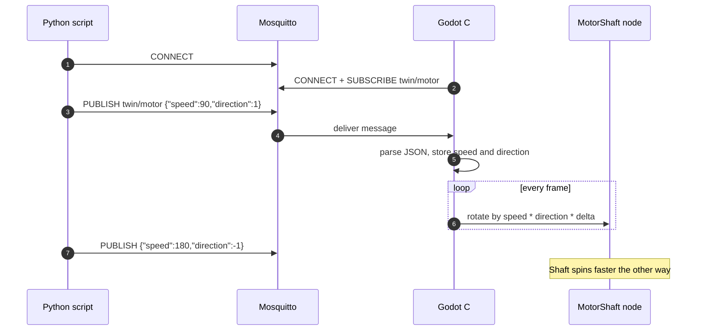

# Quiz 3 — Preparation guide (Blender · Godot · MQTT · Python)

- **Date:** 11 November 2026  
- **Time:** 09:30–11:30  
- **Room:** CB40610  
- **Weight:** **40%** of the course grade  
- **Tools:** Blender · Godot **.NET (C#)** · Python 3.11+ · MQTT (Docker Mosquitto) · MQTTX (test only)

This document tells you **what to practice before Quiz 3**. It is a preparation guide, not the sealed exam paper. The real quiz may use a different 3D object or topic name, but the skills below are what you will be tested on.

Quiz 3 builds on Weeks 10–13 (telemetry and twin sync) and on the labs: you must connect a **Python MQTT client** to a **Godot scene** that shows a model you prepared in **Blender**.

---

## 1. Learning outcomes (what you must be able to do)

| # | Skill | Practice with |
|---|---|---|
| 1 | **3D modeling in Blender** | Simple engineering part (e.g. motor body + shaft) |
| 2 | **Import Blender → Godot** | Export / import workflow; correct scale, pivot, materials |
| 3 | **Godot C# + MQTT** | Subscribe (and optionally publish); move/rotate objects from messages |
| 4 | **Python MQTT client** | Publish commands / telemetry that drive the Godot scene |

If you can complete the **example question** in §5 end-to-end on your laptop, you are close to ready.

---

## 2. System you will use in the quiz

Quiz 3 follows the course stack: **Python owns commands / numbers**, **Godot visualizes**, **MQTT carries messages**. MQTTX is for checking only.

```
┌──────────────────┐  publish           ┌─────────────────┐  deliver          ┌──────────────────┐
│ Python script    │ ──────────────────►│    Mosquitto    │ ─────────────────►│ Godot scene (C#) │
│ (MQTT client)    │  e.g. twin/motor   │ localhost:1883  │  same topic       │ rotate / animate │
└──────────────────┘                    └────────┬────────┘                   └──────────────────┘
                                                 │
                                                 │ optional inspect
                                                 ▼
                                        ┌─────────────────┐
                                        │ MQTTX (test)    │
                                        └─────────────────┘
```

**Ownership rule (same as labs):** Godot does not invent process values. It applies what arrives on MQTT. Python (or MQTTX during a quick test) publishes those values.

Related labs:

| Lab | Folder | Why it matters for Quiz 3 |
|---|---|---|
| 01 | [labs/docker](../labs/docker/README.md) | Broker on `localhost:1883` |
| 02 | [labs/simulator](../labs/simulator/README.md) | Python MQTT publish pattern |
| 03A | [labs/godot-simple](../labs/godot-simple/README.md) | C# MQTT subscribe + smooth rotate/transform |
| 03 | [labs/godot](../labs/godot/README.md) | Full twin pattern (telemetry / commands) |

---

## 3. What to prepare (checklist)

### 3.1 Blender — 3D modeling

Practice until you can, without notes:

- [ ] Create a simple **motor** (or similar): housing + **rotating shaft** as a separate object  
- [ ] Set a sensible **origin / pivot** on the shaft (rotation center)  
- [ ] Apply scale/rotation (`Ctrl+A`) before export  
- [ ] Name objects clearly (`MotorBody`, `MotorShaft`)  
- [ ] Export for Godot (typically **glTF 2.0** `.glb` / `.gltf`, or the workflow taught in class)

Playlist support: Blender INC111 list in [student-learning-plan.md](../student-learning-plan.md). Topic notes: [topic-03](../topics/topic-03-blender-modeling.md), [topic-04](../topics/topic-04-blender-to-godot.md).

### 3.2 Import Blender model into Godot

- [ ] New or existing Godot **.NET** project opens and builds  
- [ ] Import the model; place it in a scene  
- [ ] Hierarchy is correct: body static, **shaft** is the node you rotate  
- [ ] Pivot is correct (shaft spins in place, not around the world origin by mistake)  
- [ ] Units / scale look right next to a simple floor or reference box  

### 3.3 Godot C# — control objects + MQTT client

- [ ] Attach a C# script to the shaft (or a parent controller)  
- [ ] Connect to MQTT (`localhost:1883`) with **MQTTnet** (see Lab 03A `SimpleMqttClient`)  
- [ ] Subscribe to a topic such as `twin/motor`  
- [ ] Parse JSON on the **main thread** (queue pattern — do not update nodes from the MQTT callback thread)  
- [ ] Drive **speed** and **direction** (e.g. degrees/sec and sign, or `rpm` + `direction`)  
- [ ] Optional: smooth motion with `lerp` / continuous rotation in `_Process`  

Practice project: [labs/godot-simple](../labs/godot-simple/README.md) (`twin/rotate`, `twin/transform`).

### 3.4 Python — MQTT client that controls the Godot scene

- [ ] Virtualenv + `paho-mqtt` (or the client used in Lab 02)  
- [ ] Connect to `localhost:1883`  
- [ ] Publish JSON to the same topic Godot subscribes to  
- [ ] Change **speed** and **direction** from the script (constants, CLI args, or a tiny loop)  
- [ ] Confirm with MQTTX, then confirm the Godot shaft moves  

Practice: Lab 02 publisher style in [labs/simulator](../labs/simulator/README.md); keep your Quiz 3 script **small and clear**.

---

## 4. Suggested message contract (for practice)

Agree one JSON shape and stick to it in both Python and Godot.

**Topic:** `twin/motor`

```json
{
  "speed": 90,
  "direction": 1
}
```

| Field | Meaning | Example |
|---|---|---|
| `speed` | Rotation speed (degrees per second) | `0` = stop, `90` = slow, `360` = 1 rev/s |
| `direction` | Sign of rotation | `1` = forward, `-1` = reverse, `0` = stop |

Godot each frame (conceptually):

```text
omega = speed * direction
shaft.RotateY(DegToRad(omega * delta))
```

You may use `rpm` instead of `speed` if you document the conversion. Consistency between Python and C# matters more than the exact field names.

---

## 5. Example question (practice this end-to-end)

> **Simple question (example)**  
> Write a **Python script** that controls the **speed** and **direction** of a **motor** in a Godot scene over MQTT.  
> The motor (or its shaft) must be a 3D object you prepared (Blender → Godot).  
> A Godot **C#** script must subscribe to MQTT and spin the shaft according to the messages.

### 5.1 Expected student workflow



### 5.2 Minimum deliverables for this practice (mirror likely quiz packaging)

| File | Role |
|---|---|
| `motor.blend` or exported `.glb` | Source / imported model |
| Godot project with scene + C# MQTT script | Visual twin |
| `motor_control.py` | Publishes speed / direction |
| Short note (optional) | Topic name + JSON fields |

### 5.3 Self-test rubric

| Check | Pass if |
|---|---|
| Model | Shaft pivots correctly in Godot |
| Broker | Lab 01 up; both clients connect |
| Python | Changing `speed` / `direction` changes published JSON |
| Godot | Shaft speed and direction follow messages within ~1 s |
| Threading | No crashes from updating nodes off the main thread |

---

## 6. Exam-day logistics (plan for these)

| Item | Plan |
|---|---|
| Time / room | 09:30–11:30 · CB40610 |
| Bring | Laptop with Blender, Godot .NET, Python, Docker (or class broker), chargers |
| Network | Be able to run Mosquitto locally (`labs/docker`) if the room broker is unavailable |
| Integrity | Follow invigilator rules; use only allowed templates/assets if provided on the day |

Exact hand-in filenames and scoring breakdown will be on the **official Quiz 3 sheet** distributed in the room.

---

## 7. Study order (recommended)

1. Review Godot playlist Weeks 5–8 and class work from Weeks 10–13 in [student-learning-plan.md](../student-learning-plan.md).  
2. Complete **Lab 01** (broker) + **Lab 02** (Python MQTT) + **Lab 03A** (Godot MQTT motion).  
3. Model a motor shaft in Blender; import into a small Godot scene.  
4. Wire C# subscribe → shaft rotation.  
5. Write `motor_control.py` and prove control from Python only (no keyboard).  
6. Rehearse once with MQTTX watching `twin/motor`.

---

## 8. Links

| Resource | Link |
|---|---|
| Student learning plan | [../student-learning-plan.md](../student-learning-plan.md) |
| Lab 01 Docker MQTT | [../labs/docker/README.md](../labs/docker/README.md) |
| Lab 02 Python simulator | [../labs/simulator/README.md](../labs/simulator/README.md) |
| Lab 03A Godot MQTT warmup | [../labs/godot-simple/README.md](../labs/godot-simple/README.md) |
| Lab 03 Godot twin | [../labs/godot/README.md](../labs/godot/README.md) |
| System architecture | [../assignments/system-architecture.md](../assignments/system-architecture.md) |
| Quiz 1 example (format reference) | [quiz1-example_blender.md](quiz1-example_blender.md) |
