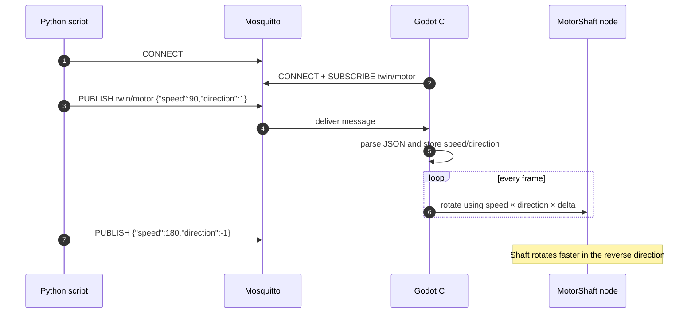

# Quiz 3 — Preparation Guide (Topics 10–15 · Blender · Godot · MQTT · Python)

- **Date:** 18 November 2026
- **Time:** 09:30–11:30
- **Room:** CB40610
- **Total weight:** **40%** of the course grade (two parts)
- **Part A scope:** Topics 10–15
- **Tools (programming part):** Blender · Godot **.NET (C#)** · Python 3.11+ · MQTT (Docker Mosquitto) · MQTTX (inspection/testing only)

This document explains what to study and practice before Quiz 3. It is a preparation guide, not the sealed exam paper. The actual quiz may use a different 3D object, process, topic name, or message payload, but it will assess the skills and concepts described here.

---

## 0. Two parts (grading)

| Part | Format | Weight | Scope |
|---|---|---:|---|
| **A — Theory** | **Paper-based** (written) | **20%** | Topics 10–15: MQTT communication, real-time synchronization, supervisory control and safety, fault injection, AI-agent tools, and agent-driven diagnosis/testing |
| **B — Programming** | Laptop / practical | **20%** | Blender model → Godot import → Godot C# MQTT client → Python MQTT publisher that drives the scene |
| | **Total** | **40%** | |

```text
Quiz 3 (40%)
├── Part A: Theory — paper-based (20%) — Topics 10–15
└── Part B: Programming — laptop/practical (20%) — Blender → Godot ↔ MQTT ↔ Python
```

**Part A** — bring pens; follow the invigilator's instructions.  
**Part B** — bring a charged laptop with the course toolchain installed (see §6).

The theory section covers Topics 10–15. The programming section assesses the practical integration workflow: a model prepared in Blender is imported into Godot, and a Python MQTT client sends data that the Godot C# application receives and uses to update the scene.

---

## 1. Learning outcomes (what you must be able to do)

### Part A — Theory (Topics 10–15)

Be ready to explain, interpret, or analyze short engineering scenarios involving the following:

| Topic | Required understanding |
|---|---|
| **10 — MQTT Communication** | Publisher, subscriber, broker, topics and wildcards, publish/subscribe flow, QoS at a conceptual level, retained messages, Last Will, telemetry versus command messages, and JSON message structure |
| **11 — Real-Time Twin Synchronization** | Source and arrival time, timestamps, sequence numbers, latency, dropped/duplicated/out-of-order messages, stale-data detection, and interpolation versus measured engineering values |
| **12 — Supervisory Control and Safety** | Supervisory versus regulatory control, command validation, operating modes, permissions, engineering limits, interlocks, acknowledgments, event logs, and deterministic safety |
| **13 — Fault Injection and Test Scenarios** | Disturbance versus fault, sensor/actuator/process/communication faults, repeatable fault injection, expected symptoms, detection delay, false alarms, and test pass criteria |
| **14 — AI Agent Tools and Structured Actions** | AI agent versus chatbot or prediction model, observe/reason/act/verify workflow, restricted tools, structured action schemas, validation, authorization, and audit logs |
| **15 — Agent-Driven Diagnosis and Testing** | Evidence-based fault hypotheses, diagnostic tests, uncertainty, diagnosis accuracy, detection delay, false-action rate, bounded recovery actions, and post-action verification |

Additional system principles:

- Python/simulator owns authoritative process state; Godot visualizes it and sends requests through the defined command path.
- MQTT is the message transport; the broker does not implement process or safety logic.
- An AI agent must use explicitly permitted tools and must not bypass the deterministic validation gateway, interlocks, or safety limits.
- A command is not confirmed until the system returns an acknowledgment or event.
- Diagnosis and recovery decisions must be supported by telemetry and other observable evidence.

### Part B — Programming (practical)

| # | Skill | Practice with |
|---|---|---|
| 1 | **3D modeling in Blender** | A simple engineering part with separate static and moving components |
| 2 | **Import Blender → Godot** | Export/import workflow, correct scale, hierarchy, pivot, and materials |
| 3 | **Godot C# + MQTT** | Connect, subscribe, receive JSON, safely pass received data to the main thread, and update scene nodes |
| 4 | **Python MQTT client** | Connect to the broker and publish correctly structured messages that drive the Godot scene |
| 5 | **Integration testing** | Verify the complete data path, message topic/payload agreement, and expected visual response |

The programming task focuses on the Blender–Godot–MQTT–Python integration workflow. The AI-agent concepts in Topics 14–15 are included in the theory scope; an external LLM service is not required for the programming task unless explicitly stated on the official exam sheet.

---

## 2. System used in the programming section

The course stack follows this ownership model:

- **Python** owns process values or publishes the control values specified in the task.
- **MQTT/Mosquitto** transports messages between clients.
- **Godot (C#)** receives messages and updates the digital-twin visualization.
- **MQTTX** is used to inspect or test messages; it is not the primary application controller.

```text
┌──────────────────┐  publish       ┌─────────────────┐  deliver       ┌──────────────────┐
│ Python script    │ ──────────────► │ Mosquitto       │ ─────────────► │ Godot scene (C#) │
│ MQTT client      │                 │ localhost:1883  │                │ visualize/update │
└──────────────────┘                 └────────┬────────┘                └──────────────────┘
                                              │
                                              ▼
                                     ┌─────────────────┐
                                     │ MQTTX           │
                                     │ inspect/test    │
                                     └─────────────────┘
```

**Ownership rule:** Godot must not invent authoritative process values. It applies the data it receives and, where required, sends commands through the agreed message contract. The Python simulator validates commands and maintains authoritative process state.

Related labs:

| Lab | Folder | Why it matters for Quiz 3 |
|---|---|---|
| 01 | [labs/docker](../labs/docker/README.md) | Broker on `localhost:1883` |
| 02 | [labs/simulator](../labs/simulator/README.md) | Python MQTT publisher and simulator patterns |
| 03A | [labs/godot-simple](../labs/godot-simple/README.md) | C# MQTT subscribe and smooth rotate/transform |
| 03 | [labs/godot](../labs/godot/README.md) | Full twin pattern: telemetry, commands, and events |

---

## 3. What to prepare (checklist)

### 3.1 Blender — 3D modeling

Practice until you can, without notes:

- [ ] Create a simple engineering object (for example, a motor housing and a separate rotating shaft).
- [ ] Set a suitable origin/pivot on each moving part.
- [ ] Apply scale/rotation (`Ctrl+A`) before export when appropriate.
- [ ] Name objects clearly (for example, `MotorBody`, `MotorShaft`).
- [ ] Export for Godot, typically using glTF 2.0 (`.glb` / `.gltf`) or the workflow taught in class.

Playlist support: Blender INC111 list in [student-learning-plan.md](../student-learning-plan.md). Topic notes: [Topic 3](../topics/topic-03-blender-modeling.md), [Topic 4](../topics/topic-04-blender-to-godot.md).

### 3.2 Import Blender model into Godot

- [ ] Open a Godot **.NET** project and confirm that it builds.
- [ ] Import the model and place it in a scene.
- [ ] Keep the hierarchy meaningful: static body and separately controllable moving part.
- [ ] Check that the pivot is correct; the moving part must rotate around its intended axis.
- [ ] Check units, scale, orientation, and materials.

### 3.3 Godot C# — control objects and MQTT client

- [ ] Attach a C# script to the moving node or an appropriate parent/controller.
- [ ] Connect to MQTT (`localhost:1883`) using MQTTnet, following the class lab.
- [ ] Subscribe to the topic specified in the task (for practice, `twin/motor`).
- [ ] Receive and parse JSON safely.
- [ ] Do not update Godot scene nodes directly from an MQTT callback thread; pass received data to the main thread using a queue or equivalent safe pattern.
- [ ] Use received values to control a scene property such as rotation speed, direction, position, or level.
- [ ] Optionally smooth visual motion in `_Process` without changing the authoritative measurement.

Practice project: [labs/godot-simple](../labs/godot-simple/README.md) (`twin/rotate`, `twin/transform`).

### 3.4 Python — MQTT client that controls the Godot scene

- [ ] Create/use a virtual environment and install `paho-mqtt` (or the client used in Lab 02).
- [ ] Connect to `localhost:1883`.
- [ ] Publish JSON to the topic to which Godot subscribes.
- [ ] Use the exact field names, data types, and units required by the task.
- [ ] Change values in the script and verify that the Godot scene responds.
- [ ] Use MQTTX to inspect the topic and payload when debugging.

Practice: Lab 02 publisher style in [labs/simulator](../labs/simulator/README.md). Keep the script small, readable, and testable.

---

## 4. Suggested message contract for practice

Use one consistent JSON shape in both Python and Godot.

**Topic:** `twin/motor`

```json
{
  "speed": 90,
  "direction": 1
}
```

| Field | Meaning | Example |
|---|---|---|
| `speed` | Rotation speed in degrees per second | `0` = stop, `90` = 90°/s, `360` = one revolution per second |
| `direction` | Direction/sign of rotation | `1` = forward, `-1` = reverse, `0` = stop |

Conceptual Godot update:

```text
omega = speed * direction
shaft.RotateY(DegToRad(omega * delta))
```

You may use `rpm` instead of `speed` if the conversion is documented. Consistency between Python and C# matters more than the particular field names.

---

## 5. Example practice task — Part B programming

> Write a **Python script** that controls the **speed** and **direction** of a motor in a Godot scene over MQTT. The motor (or its shaft) must be a 3D object prepared in Blender and imported into Godot. A Godot **C#** script must subscribe to MQTT and rotate the shaft according to the received messages.

### 5.1 Expected workflow



### 5.2 Minimum practice deliverables

| File | Role |
|---|---|
| `motor.blend` or exported `.glb` | Source model |
| Godot project with scene and C# MQTT script | Digital twin |
| `motor_control.py` | Publishes speed/direction |
| Short note | Topic name, JSON fields, and units |

### 5.3 Self-test rubric

| Check | Pass if |
|---|---|
| Model | Moving part has the correct pivot in Godot |
| Broker | Mosquitto is running and both clients connect |
| Python | Changing speed/direction changes the published JSON |
| Godot | Shaft follows the received speed/direction |
| Threading | Scene nodes are updated safely on the Godot main thread |
| Integration | Topic and payload agree between Python and Godot |

---

## 6. Exam-day logistics

| Item | Plan |
|---|---|
| Date / time / room | **18 November 2026** · 09:30–11:30 · CB40610 |
| Part A (20%) | Paper-based theory covering Topics 10–15 |
| Part B (20%) | Practical programming using Blender, Godot .NET, Python, and MQTT |
| Laptop | Bring a charged laptop and charger; verify all required software before exam day |
| Network | Be prepared to run Mosquitto locally using [Lab 01](../labs/docker/README.md) if the classroom broker is unavailable |
| Integrity | Follow invigilator instructions and use only templates/assets permitted on the day |

Exact hand-in filenames, time allocation, and detailed scoring will be stated on the official Quiz 3 sheet distributed in the room.

---

## 7. Recommended study order

1. Review Topics 10–15 in [teaching-schedule.md](../teaching-schedule.md) and the detailed notes in [topics/](../topics/).
2. Review the MQTT broker, topic, QoS, retained-message, and Last Will concepts; complete Lab 01.
3. Review Python publishing and structured JSON; complete Lab 02.
4. Review Godot C# subscription, safe main-thread updates, and visual control; complete Lab 03A.
5. Prepare a Blender model with a moving part and import it into Godot.
6. Complete the end-to-end Python → MQTT → Godot practice task.
7. Review Topics 12–15 especially: validation gateway, deterministic safety, fault scenarios, restricted AI tools, evidence-based diagnosis, and verification after actions.

---

## 8. Links

| Resource | Link |
|---|---|
| Student learning plan | [../student-learning-plan.md](../student-learning-plan.md) |
| Teaching schedule | [../teaching-schedule.md](../teaching-schedule.md) |
| Topic 10 — MQTT | [../topics/topic-10-mqtt-communication.md](../topics/topic-10-mqtt-communication.md) |
| Topic 11 — Synchronization | [../topics/topic-11-real-time-synchronization.md](../topics/topic-11-real-time-synchronization.md) |
| Topic 12 — Supervisory Control and Safety | [../topics/topic-12-supervisory-control.md](../topics/topic-12-supervisory-control.md) |
| Topic 13 — Fault Injection | [../topics/topic-13-fault-injection.md](../topics/topic-13-fault-injection.md) |
| Topic 14 — AI Agent Tools | [../topics/topic-14-ai-agent-tools.md](../topics/topic-14-ai-agent-tools.md) |
| Topic 15 — Agent Diagnosis and Testing | [../topics/topic-15-agent-diagnosis-and-testing.md](../topics/topic-15-agent-diagnosis-and-testing.md) |
| Lab 01 Docker MQTT | [../labs/docker/README.md](../labs/docker/README.md) |
| Lab 02 Python simulator | [../labs/simulator/README.md](../labs/simulator/README.md) |
| Lab 03A Godot MQTT warmup | [../labs/godot-simple/README.md](../labs/godot-simple/README.md) |
| Lab 03 Godot twin | [../labs/godot/README.md](../labs/godot/README.md) |
| System architecture | [../assignments/system-architecture.md](../assignments/system-architecture.md) |
| Quiz 1 example (format reference) | [quiz1-example_blender.md](quiz1-example_blender.md) |
